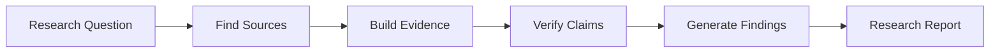
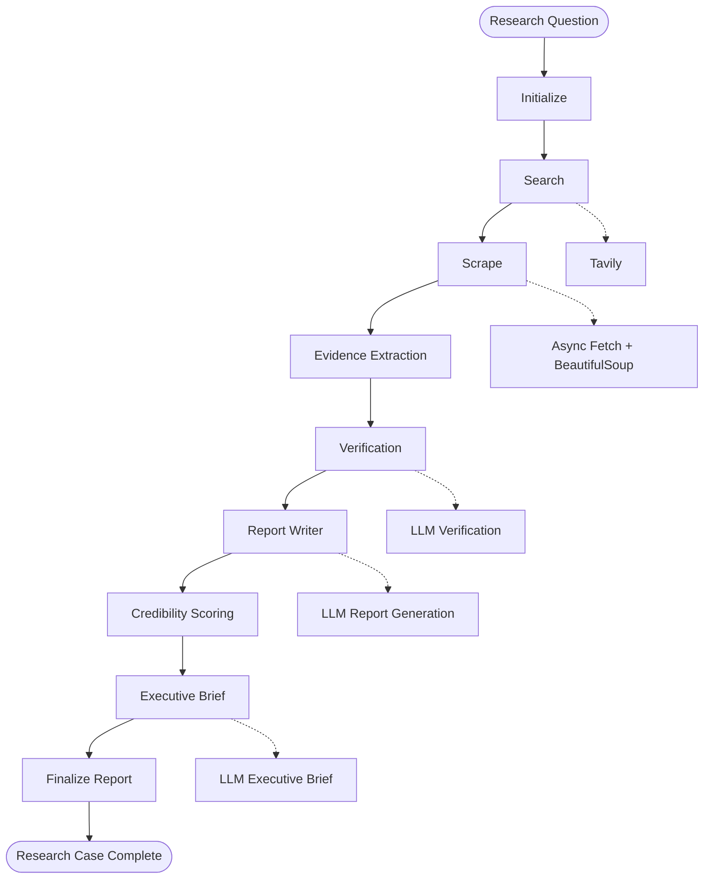
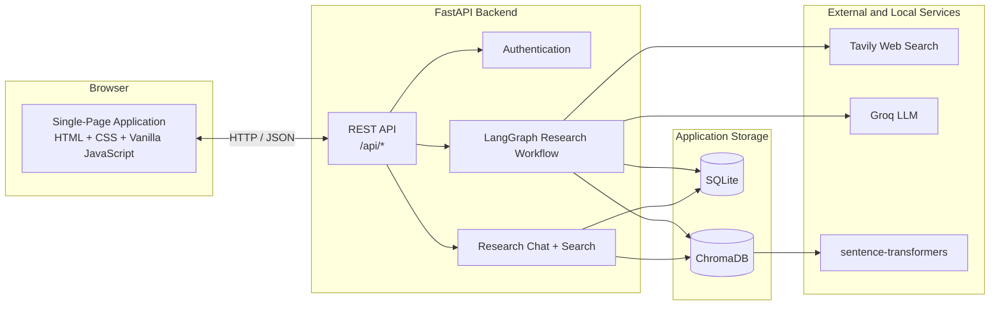
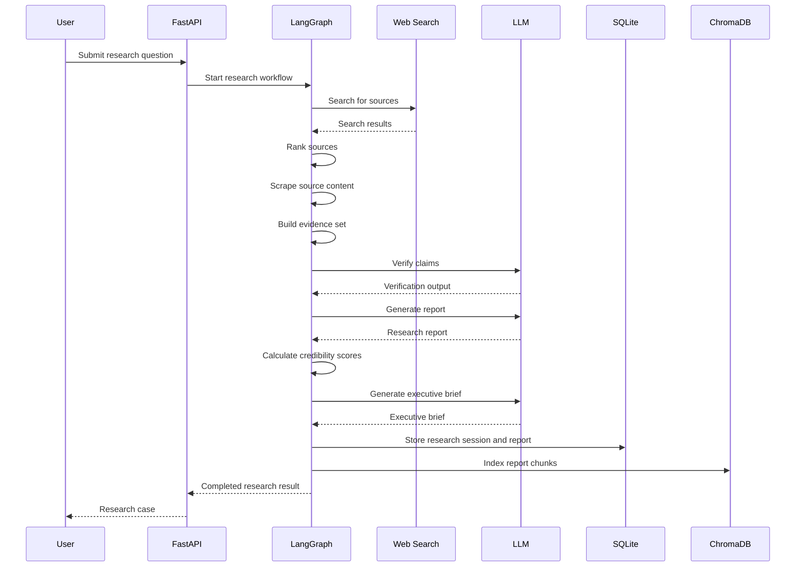
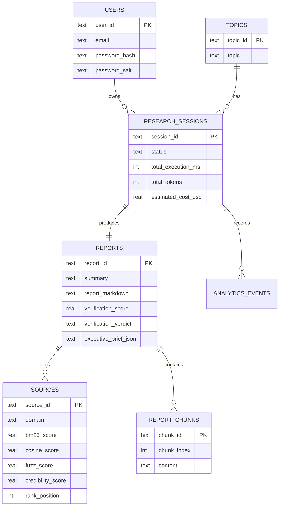
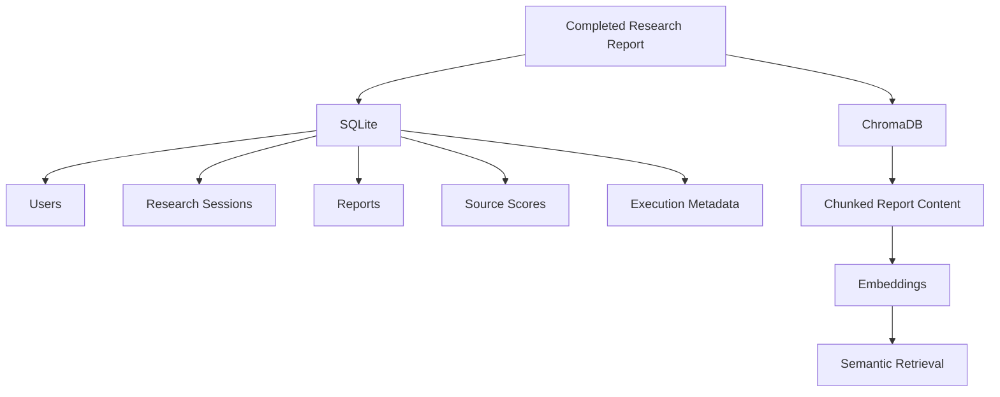
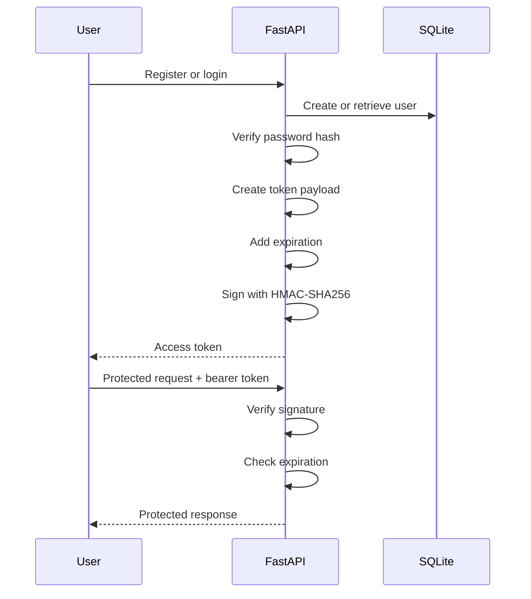

# Atlas

## A student-first research workspace

Atlas is a research workspace built around a complete research flow:

**Question → Research → Evidence → Notes → Findings → Output**

A user starts with a research question. Atlas searches for relevant sources, ranks them, processes the retrieved content into an evidence set, verifies claims against that evidence, and produces a structured research report.

The project keeps the research process as part of the final result. A research case stores the sources that were used, the evidence produced during processing, verification results, report output, and execution metadata. Completed reports are also indexed for semantic retrieval so previous research can be found later by meaning rather than only by exact keywords.

Atlas is a personal engineering project built to explore how web research, evidence processing, retrieval, language models, and persistent research history can work together in one application.

---

## What Atlas does

A typical research run follows this path:



The application is designed around the stages of research rather than treating the entire process as a single prompt to a language model.

### During a research run, Atlas:

* Searches the web for relevant sources.
* Ranks sources using multiple relevance signals.
* Retrieves and processes source content.
* Merges extracted material into an evidence set.
* Uses the evidence during claim verification.
* Generates a structured research report.
* Scores source credibility separately from relevance.
* Produces an executive brief containing key insights, risks, and next steps.
* Stores the completed research case and its metadata.
* Indexes report content for later semantic search.

## Demo Visuals 


---

# Features

## Multi-stage research pipeline

Research is orchestrated through a LangGraph `StateGraph`.

A single shared state object moves through the pipeline, allowing each stage to access the outputs produced by earlier stages.

The current workflow contains the following stages:



The graph separates deterministic processing from language-model tasks.

Ranking and credibility calculations remain deterministic, while the LLM is used for tasks where language understanding is required.

---

## Source ranking

Atlas does not rely on a single relevance score when ordering sources.

The ranking process combines:

* BM25
* TF-IDF
* Cosine similarity
* Fuzzy string matching using RapidFuzz

These signals are used together to produce source relevance scores.

This is intentionally separate from credibility assessment. A source can be relevant to a question without necessarily being the most credible source available.

---

## Source credibility

Source credibility is evaluated separately from relevance.

The credibility pass considers:

* Domain reputation
* Publication-date freshness
* Corroboration from other sources

This separation allows the research workflow to distinguish between:

* **How relevant a source is to the question**
* **How trustworthy the source appears within the available evidence**

---

## Evidence and verification

Source content is processed into an evidence set before verification.

Claims are evaluated against the available evidence and categorized as:

* **Supporting**
* **Uncertain**
* **Conflicting**

The project avoids reducing verification to a single unexplained confidence value. The research result retains the relationship between claims and the evidence used during verification.

---

## Semantic research history

Completed reports are stored in two different forms.

Structured research data is stored in SQLite.

Report content is chunked and indexed in ChromaDB for semantic retrieval.

This allows Atlas to retrieve previous research based on meaning.

For example, a search related to:

> coping with chronic stress

can retrieve a previous research case about:

> burnout recovery strategies

even when the wording does not overlap exactly.

Atlas also includes a research chat endpoint for asking follow-up questions grounded in stored research.

---

# System Architecture



### Component responsibilities

| Component             | Responsibility                                              |
| --------------------- | ----------------------------------------------------------- |
| Frontend              | Research workspace and application navigation               |
| FastAPI               | API routes, request handling, authentication                |
| LangGraph             | Research workflow orchestration                             |
| Tavily                | Web source discovery                                        |
| Groq                  | Verification, report generation, executive brief generation |
| SQLite                | Structured application and research data                    |
| ChromaDB              | Semantic indexing and retrieval                             |
| sentence-transformers | Local embedding generation                                  |

---

# Research Execution Flow

The following sequence shows how a research request moves through the application.



---

# Data Model

Atlas uses SQLite for structured application data.

The primary research entities are organized around users, research sessions, reports, sources, and report chunks.



---

# Why Atlas uses SQLite and ChromaDB

The project uses two storage systems because the data has two different access patterns.



SQLite is used for structured information that can be queried directly.

ChromaDB is used for semantic retrieval over report content.

The two stores serve different purposes rather than duplicating the same database responsibilities.

---

# Authentication

Atlas uses email and password authentication.

The authentication implementation includes:

* PBKDF2-HMAC password hashing
* 200,000 hashing iterations
* Password salts
* HMAC-SHA256 signed access tokens
* Token expiration
* Protected API routes

The implementation uses Python's standard-library `hashlib` and `hmac` primitives rather than an external authentication provider.



---

# Frontend

The frontend is implemented without a JavaScript framework.

The application is a single-page interface built with:

* HTML
* CSS
* Vanilla JavaScript
* A small `fetch`-based API client

The primary navigation follows the user's research workflow:

> **Home → Research → Cases → Ask Atlas → Insights → Library**

Inside a research case:

> **Overview → Sources → Evidence → Notes → Findings**

The frontend labels are intentionally based on research activities rather than internal backend terminology.

---

# Tech Stack

| Layer              | Technology                         | Usage                              |
| ------------------ | ---------------------------------- | ---------------------------------- |
| Backend            | Python + FastAPI                   | API and application backend        |
| Workflow           | LangGraph                          | Research pipeline orchestration    |
| LLM                | Groq + Llama 3.3 70B               | Verification and report generation |
| Search             | Tavily                             | Web source discovery               |
| Ranking            | BM25 + TF-IDF + Cosine + RapidFuzz | Source relevance                   |
| Vector Store       | ChromaDB                           | Semantic search                    |
| Embeddings         | `all-MiniLM-L6-v2`                 | Local vector embeddings            |
| Relational Storage | SQLite                             | Application and research metadata  |
| Authentication     | PBKDF2-HMAC + HMAC tokens          | Passwords and sessions             |
| Frontend           | HTML + CSS + Vanilla JavaScript    | Research workspace                 |

---

# Project Structure

```text
atlas/
│
├── main.py
├── requirements.txt
├── start.py
├── start.sh
├── start.bat
│
├── backend/
│   │
│   ├── api/
│   │   └── routes/
│   │       ├── auth
│   │       ├── research
│   │       ├── chat
│   │       ├── search
│   │       ├── history
│   │       ├── analytics
│   │       ├── knowledge_base
│   │       └── settings
│   │
│   ├── graph/
│   │   ├── state.py
│   │   ├── nodes.py
│   │   └── workflow.py
│   │
│   ├── agents/
│   │   ├── verification_agent
│   │   ├── writer_agent
│   │   └── executive_brief_agent
│   │
│   ├── services/
│   │   ├── ranking
│   │   ├── credibility
│   │   ├── retrieval
│   │   ├── scraping
│   │   ├── content_merge
│   │   └── tavily
│   │
│   ├── memory/
│   │   ├── ChromaDB client
│   │   ├── embedding service
│   │   └── vector retrieval
│   │
│   ├── database/
│   │   ├── SQLite schema
│   │   └── repositories
│   │
│   ├── auth/
│   │   ├── password hashing
│   │   └── token handling
│   │
│   ├── models/
│   │   └── Pydantic models
│   │
│   └── core/
│       ├── settings
│       ├── LLM client
│       └── logging
│
└── frontend/
    ├── landing.html
    ├── landing.js
    ├── index.html
    ├── script.js
    └── style.css
```

---

# Getting Started

## 1. Clone the repository

```bash
git clone <repository-url>
cd atlas
```

## 2. Configure environment variables

Create a `.env` file from the provided example:

```bash
cp .env.example .env
```

Add your API keys:

```env
GROQ_API_KEY=your_key
TAVILY_API_KEY=your_key
```

## 3. Run Atlas

### macOS / Linux

```bash
./start.sh
```

### Windows

Run:

```text
start.bat
```

The startup scripts handle:

* Virtual environment creation
* Dependency installation
* FastAPI backend startup
* Static frontend startup
* Application health verification

---

## Local URLs

| Service                       | URL                                  |
| ----------------------------- | ------------------------------------ |
| API                           | `http://localhost:8000`              |
| Interactive API documentation | `http://localhost:8000/docs`         |
| Frontend                      | `http://localhost:5500/landing.html` |

---

# API Reference

All application routes are available under `/api`.

Authentication routes are public. Other routes require an authenticated bearer token.

| Method     | Endpoint                                 | Purpose                              |
| ---------- | ---------------------------------------- | ------------------------------------ |
| POST       | `/api/auth/register`                     | Create an account                    |
| POST       | `/api/auth/login`                        | Authenticate a user                  |
| GET        | `/api/auth/me`                           | Retrieve the current user            |
| POST       | `/api/research/run`                      | Run the research workflow            |
| POST       | `/api/chat/research`                     | Ask follow-up research questions     |
| POST       | `/api/search/semantic`                   | Search stored research semantically  |
| GET        | `/api/history/reports`                   | List research cases                  |
| GET        | `/api/history/report/{report_id}`        | Retrieve a research case             |
| GET        | `/api/analytics/overview`                | Retrieve research analytics          |
| GET        | `/api/knowledge-base`                    | Retrieve stored research information |
| DELETE     | `/api/knowledge-base/report/{report_id}` | Delete a report and indexed content  |
| GET / POST | `/api/settings`                          | Read or update account settings      |

---

# Engineering Decisions

## Ranking is deterministic

Source ranking and credibility scoring do not require an LLM.

Atlas keeps operations such as:

* BM25 scoring
* Cosine similarity
* Fuzzy matching
* Domain reputation checks
* Date calculations

outside the language-model pipeline.

This keeps scoring reproducible and avoids spending LLM calls on arithmetic or retrieval tasks.

---

## LLM usage is limited to language tasks

A research run uses the LLM for tasks such as:

* Claim verification
* Report writing
* Executive brief generation

Evidence size is capped through `max_evidence_chars_per_llm_call`.

The application also includes retry handling for rate limits so a temporary `429` response does not immediately terminate the research workflow.

---

## Storage responsibilities are separated

SQLite is the source of truth for structured research records.

ChromaDB is used for semantic recall.

The system does not attempt to use the vector store as a general-purpose relational database or SQLite as a semantic search engine.

---

# Known Limitations

The following limitations reflect the current implementation.

## Password reset is not implemented in the backend

The frontend includes a forgot-password and reset-password flow, but the backend does not currently implement those endpoints.

Current backend authentication functionality includes:

* Registration
* Login
* Current-user retrieval

---

## Notes are stored locally

The Notes tab currently uses browser `localStorage`.

Notes persist on the same browser and device but are not synchronized with the backend or other devices.

A backend-backed notes model is planned but is not currently implemented.

---

## Single LLM provider

LLM-backed tasks currently use Groq.

There is no second provider configured as a fallback.

---

## Automated tests have not yet been added

The application has been exercised manually end-to-end.

Automated test coverage for services and agents is not currently included.

---

# Roadmap

* [ ] Add backend-backed notes
* [ ] Add forgot-password and reset-password endpoints
* [ ] Add automated tests for ranking and credibility scoring
* [ ] Add broader service and pipeline test coverage
* [ ] Add an optional fallback LLM provider

---

## Project Context

Atlas was built as a portfolio project to bring several engineering problems into one application:

* Web research
* Source ranking
* Content extraction
* Evidence processing
* Claim verification
* Semantic retrieval
* Persistent research history
* Authentication
* API design
* Multi-stage workflow orchestration

The project is centered on one design decision:

> **The useful output of research is not only the final report. The sources, evidence, and reasoning path used to produce it should remain accessible as part of the research case.**

---

