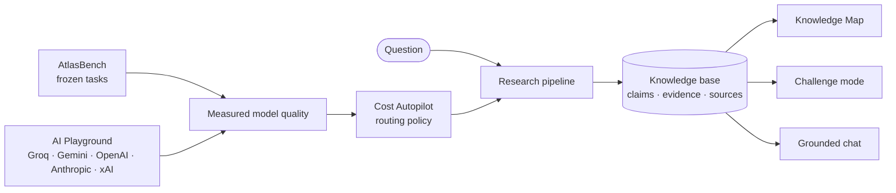

# Product overview

**Atlas: research you can trace, AI you can measure.**

## The problem

AI research assistants produce fluent reports, but a reader can't tell which claim came from which source, whether sources disagree, or whether the model behind the answer is any good. Teams also pick models by reputation and price rather than by measuring them on their own tasks.

## What Atlas does

Atlas has two halves that share one platform.

| | Research workspace | Model evaluation and control |
|---|---|---|
| **Question it answers** | "What does the evidence say, and how sure should I be?" | "Which model should answer, and can I prove it?" |
| **Core idea** | Every claim stays linked to its source and is labelled *supporting*, *uncertain* or *conflicting* | Models are ranked only on measured results from frozen tasks, never on opinion |
| **Main features** | Research pipeline, source ranking, claim verification, Knowledge Map, Challenge mode, grounded chat | AI Playground (5 providers supported), AtlasBench, Cost Autopilot routing (a tab inside AtlasBench), budgets |

The two halves meet at the routing layer. Quality scores from AtlasBench decide which model the research pipeline uses, so the measurement and the product are connected.

## Who it's for

| User | Need | What Atlas gives them |
|---|---|---|
| Analyst or researcher | Trust a report enough to act on it | Claim-level citations, conflict flags, a credibility score separate from relevance |
| AI engineer | Choose a model with evidence | Reproducible benchmark runs, side-by-side provider comparison with cost, latency and failures shown |
| Team lead | Control LLM spend | Per-user daily call limits, a monthly spend cap, unknown prices blocked when a cap is set |

## Principles

1. **Traceable.** Reports show their evidence. There is no single unexplained confidence number.
2. **Measured, not asserted.** No LLM judge. Benchmark scoring is deterministic rules over a gold answer, and metrics that don't apply are `null`, never 0.
3. **Honest about unknowns.** Unknown cost is shown as "Not reported", never as free. Unknown model quality is never "good enough" for autopilot.
4. **Safe by default.** Scraped and retrieved text is treated as untrusted data. Provider keys never leave the server. Users can't see each other's data.
5. **Bounded.** Retries, re-planning, spend, request size and concurrency all have explicit limits.

## Feature tour

**Research pipeline.** A question goes through planning, search, scraping, evidence extraction, claim verification, report writing, credibility scoring and an executive brief. The report is stored as structured data and indexed for later semantic search.

**Source ranking.** BM25, TF-IDF, cosine similarity and fuzzy matching combine into a relevance score. Credibility (domain reputation, freshness, corroboration) is scored separately so a relevant but weak source isn't mistaken for a trustworthy one.

**Knowledge Map.** Claims and entities extracted from every report form a per-user graph, with change tracking when new research contradicts old findings and freshness signals for aging sources.

**Challenge mode.** Runs deterministic adversarial queries against a finding: counter-evidence, contradiction search, source quality, temporal validity, assumption check and alternative explanation. A finding ends up *supported*, *weakened*, *contradicted*, *unresolved*, *stale* or *source concern*.

**AI Playground.** One question goes to up to four models, optionally with the same web sources. A table compares time, tokens, estimated cost and sources cited, and each model's full answer opens on its own. Five providers are supported; the demo offers free-tier Groq and Gemini models. A ranking is claimed only from the labelled evaluation suite, and only when confidence intervals do not overlap.

**AtlasBench.** Eight hand-written tasks over frozen, fictional evidence (so models can't answer from memory): clean support, contradiction, abstention, stale sources, prompt injection, multi-hop, numeric nuance and no evidence. Six measures are scored deterministically.

**Cost Autopilot.** A per-user policy picks the cheapest model that meets quality, latency and cost thresholds, using that user's own benchmark results. It falls back only on provider trouble such as timeouts, 429s and 5xx, never on validation errors or bugs.

## Scope and honest limits

- Atlas is a single-instance application backed by SQLite and a local ChromaDB. It is built to be deployed as one container, not horizontally scaled.
- Cost figures are estimates from list prices and token counts, not invoices.
- Benchmark tasks derived from the Knowledge Map have derived, not human-reviewed, gold answers, and the UI marks them as such.
- No pre-computed model rankings ship with the repo. Rankings come only from runs you do with your own keys.
