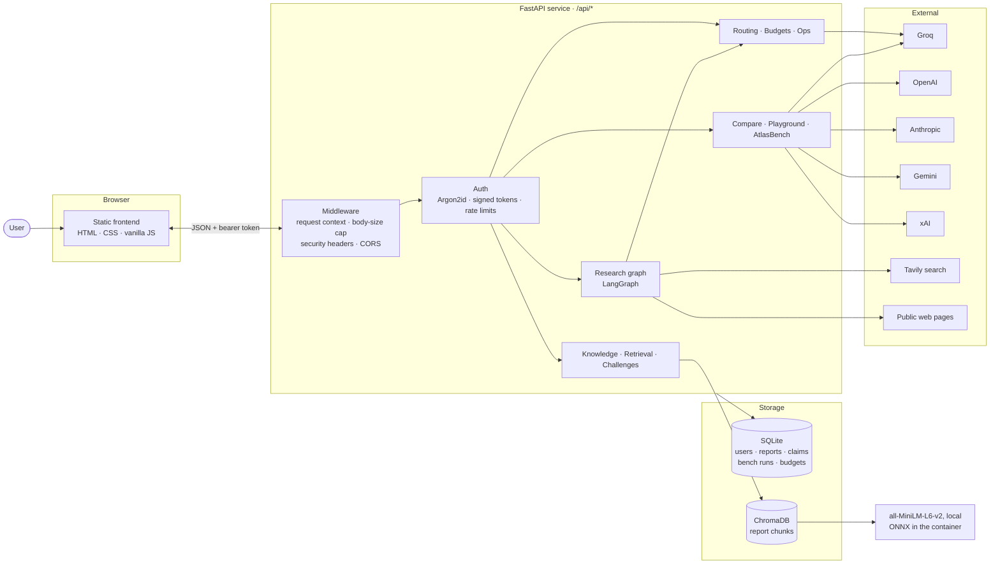
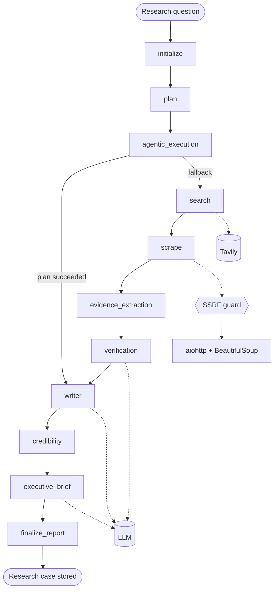
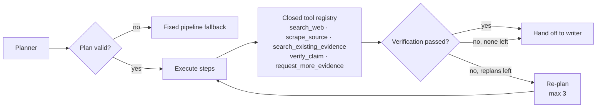
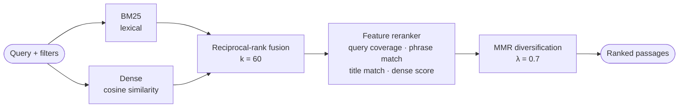
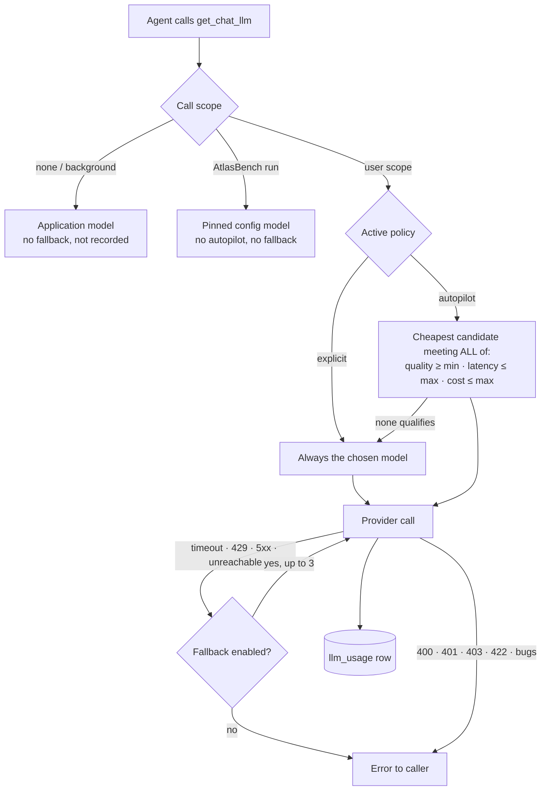
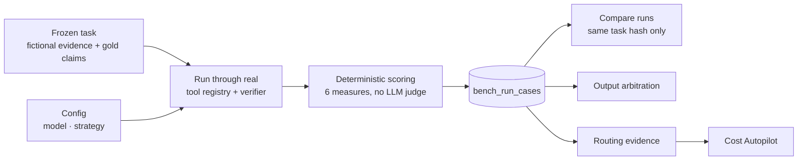
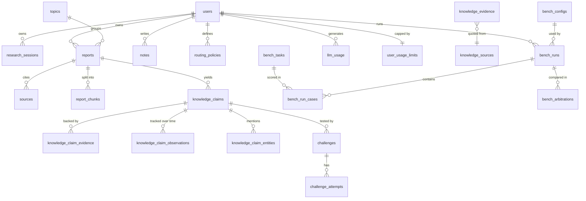
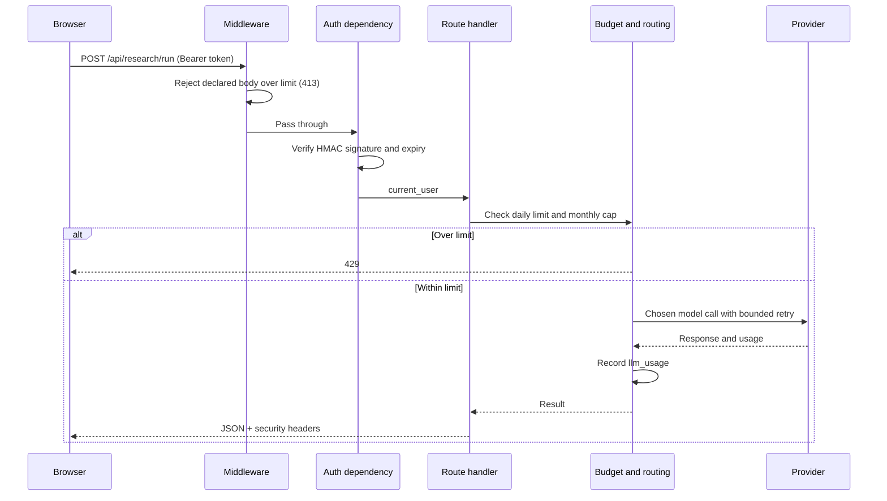
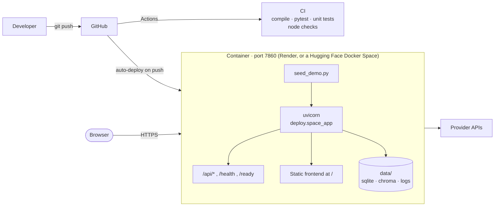

# Architecture

Atlas is a single FastAPI service with a dependency-free static frontend, two stores (SQLite and ChromaDB) and a set of external model and search providers.

## 1. System context

**Why two stores.** The data is read in two different ways. SQLite holds structured, relational records. ChromaDB holds embedded text chunks for similarity search. Neither duplicates the other, and both live under one data directory so a single volume holds all state.

**Why a static frontend.** No build step and no framework means the whole app ships as one container and the API can serve the UI from the same origin, which removes CORS from the deployed path.

## 2. Research pipeline

The pipeline is a LangGraph state machine. A plan is validated and executed over a closed tool registry. If planning fails, the run falls back to the fixed linear pipeline.

### Agentic execution

The tool registry is a closed set: only named tools can exist, each is registered once, and there is no `register` method after construction, so a model can't invent a tool. Retrieved text is wrapped as untrusted data before any model sees it.

## 3. Retrieval

Atlas searches past research with two retrievers merged by reciprocal-rank fusion, then reranks.

Defaults: 50 candidates per first-stage retriever, 30 passed to the reranker. Every query is scoped to one user and can't read another user's chunks. The reranker is a protocol, so a cross-encoder can replace it without touching the retriever.

## 4. Model routing

Agents call the language model through one function. The router sits behind it, so agent code is unchanged by routing.

Quality and latency come from the user's own most recent AtlasBench run per model. Unknown is never good enough: a model with no benchmark, price or latency is not eligible.

## 5. Evaluation loop

See [Evaluation](03-evaluation.md) for the measures and methodology.

## 6. Data model

Every user-facing table carries a `user_id`, and every repository query filters on it. Tests assert isolation between two users for research, notes, Playground, benchmark runs and routing policies.

## 7. Security and request lifecycle

| Control | Where |
|---|---|
| Argon2id password hashing, PBKDF2 legacy verify and migrate | `backend/auth/security.py` |
| HMAC-SHA256 signed expiring tokens, constant-time compare | `backend/auth/security.py` |
| Per-route rate limits for auth endpoints | `backend/auth/rate_limit.py` |
| Production startup validation (secret strength, CORS allowlist, spend cap) | `backend/core/config.py` |
| SSRF guard on page fetching | `backend/services/ssrf_guard.py` |
| Log redaction for provider token formats | `backend/core/logging.py` |
| Security headers, request-size cap, generic 500 responses | `main.py` |
| Frontend: only `http(s)` URLs reach an `href`, markdown output is escaped first | `frontend/js/script.js` |

## 8. Deployment topology

One process serves both the API and the UI, so there is a single origin and no CORS in the deployed path. The image runs as a non-root user, bakes the ONNX embedding model in at build time so startup never needs the network, and has a `HEALTHCHECK` on `/ready`. It sets four environment variables for 512 MB hosts: `ATLAS_EMBEDDING_BACKEND=onnx`, `ATLAS_DENSE_RANKING=0`, `ATLAS_MAX_TOP_K=6` and `ATLAS_LIGHT_MODE=1` (see [configuration](09-configuration.md)).

## 9. Design decisions and trade-offs

| Decision | Reason | Cost |
|---|---|---|
| SQLite and local Chroma | Zero-ops, single volume, easy to reason about | One writer process, no horizontal scale. The next step is Postgres and a hosted vector store. |
| Deterministic scoring, no LLM judge | Reproducible, cheap, explainable | Lexical overlap can miss paraphrased quotes |
| Closed tool registry | A model can't call anything not on the list | Adding a tool is a code change |
| Router behind `get_chat_llm` | Agents and the graph don't change when routing does | Context has to be carried explicitly into thread-pool calls |
| Hand-rolled signed tokens | No extra dependency, simple to audit | No revocation list. A standard JWT library would be the next step. |
| In-memory rate limiter | No Redis dependency | Per process, resets on restart |
| Small-host mode (ONNX embeddings, keyword ranking, at most 6 sources, no vector indexing) | The live demo runs on a free 512 MB instance; the full path peaked at about 870 MB | Lower semantic ranking quality on the demo, and Ask Atlas and Discover do not see new reports there. The full path stays the default everywhere else. |
| Static frontend without a framework | No build step, one container | Large hand-written `script.js` (about 2,100 lines) that would benefit from modules |
