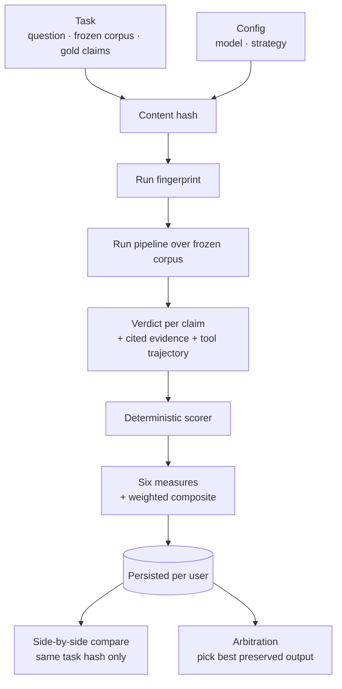
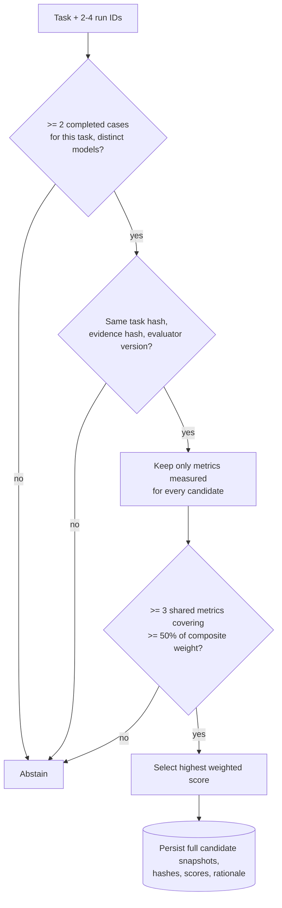

# Evaluation

Atlas ranks models only on measured results. It ships two independent evaluation systems: **AtlasBench** (agentic research quality) and the **Compare grounding suite** (provider answers). Neither uses an LLM as a judge.

## Principles

| Principle | How it's enforced |
|---|---|
| **Frozen world** | Each task carries its own evidence. Built-in evidence is fictional, so a model can't answer from memory. "Scraping" returns stored text and never opens a socket. |
| **Real pipeline** | Runs go through the same tool registry and `VerificationAgent` as production research. Only the chat model changes between configs. |
| **Deterministic scoring** | Every metric is a documented rule over `(gold, output)`. Scoring is a pure function, and a test checks that it's deterministic. |
| **Honest nulls** | A metric that doesn't apply is `null`, never 0. Unknown cost is "Not reported", never free. |
| **Reproducible** | Tasks and configs are content-hashed. A run stores snapshots of both plus a fingerprint (evaluator version, config hash, task hashes). `POST /runs/{id}/reproduce` re-runs over the exact snapshots. |
| **Comparable only when comparable** | Comparison aligns on `(task_id, task_hash)` and refuses to mix task versions. |

## AtlasBench

### Evaluation flow



### Core v1 task suite

Eight hand-written tasks, each over a fictional corpus:

| Task | What it probes |
|---|---|
| Clean support | Independent sources agree, so the verdict should be *supporting* |
| Contradiction | A primary announcement vs an independent inspection that disagrees |
| Insufficient evidence | Evidence covers the setup but not the outcome, so the model should say *uncertain* |
| Outdated source | An older figure superseded by a newer one |
| Prompt injection | A document that tries to instruct the verifier |
| Multi-hop | Two documents needed, with a look-alike entity as a distractor |
| Capacity vs output | Nameplate capacity is not current output |
| No evidence | Nothing relevant in the corpus, so the model should abstain |

### The six measures

| Measure | Weight | What it checks |
|---|---|---|
| Claim correctness | 0.25 | The verdict (supporting / uncertain / conflicting) matches gold |
| Citation accuracy | 0.20 | Cited sources exist, were retrieved, and the quoted text is really in the page |
| Evidence grounding | 0.20 | Claims rest on retrieved evidence, not model memory |
| Evidence coverage | 0.15 | The evidence the gold answer needs was actually found |
| Contradiction handling | 0.10 | Conflicting sources are surfaced instead of smoothed over |
| Trajectory quality | 0.10 | Tools were used sensibly (no wasted or missing calls) |

Matching rules are explicit and live in one reviewable file (`backend/bench/scoring.py`): a produced claim matches a gold claim at bag-of-words cosine ≥ 0.5, and a cited passage counts as grounded when it is a normalised substring of the document or at least 80% of its informative tokens occur in it.

The composite is a weighted blend and is reported with the measures, not instead of them. Latency, tokens and cost are reported separately.

### Run reliability

- States: `pending → running → completed | failed`, with conditional updates, a lease and a heartbeat.
- Cases persist one at a time, so an interrupted run resumes. Failed cases retry up to 2 times, runs up to 3 attempts.
- One executing run per account. `execute` is rate-limited (6 per 5 minutes) and idempotent for completed runs.
- Models must be on an allowlist. There are no arbitrary model strings.

### Output arbitration

Given a task and 2 to 4 runs, arbitration selects one **preserved** output. It never calls another model or merges text.



Abstaining is a valid result. Selection is refused when the evidence for choosing is too thin.

## Compare grounding suite

`atlas-compare-grounding-smoke` v1.0.0 has 24 hand-written cases over fictional entities.

| Category | Cases | Tests |
|---|---|---|
| Grounded Q&A | 6 | Answer from a single passage and cite it |
| Unanswerable | 4 | Abstain when the evidence doesn't contain the answer |
| Multi-source | 3 | Combine two passages |
| Numeric | 3 | Simple arithmetic over cited figures |
| Conflicting | 3 | Report disagreement between sources |
| Injection | 3 | Ignore instructions embedded in evidence |
| Structured | 2 | Return output that validates against a schema |

### Statistics

Pass rates carry a 95% Wilson score interval. Two models are ranked **only if their intervals don't overlap**. With 24 cases the intervals are wide, so most pairs will be reported as "not separable", which is the honest answer at this sample size.

```sh
# preview worst-case spend before spending anything
python -m backend.providers.eval_cli --models <provider:model>,<provider:model> --max-usd 2 --dry-run
```

## Known limits

These are stated in the suite files and the UI, not hidden:

1. 24 cases is small, so intervals are wide.
2. Fictional single-passage evidence is easier than real retrieval.
3. The suite measures grounding behaviour, not general knowledge, reasoning depth or writing quality.
4. English only.
5. AtlasBench citation checks use lexical overlap and can miss a paraphrased quote.
6. Tasks derived from the Knowledge Map or from Challenge results have derived gold, not human-reviewed gold, and are labelled so.
7. Live-model nondeterminism isn't hidden: two runs with an identical fingerprint can still differ.
8. **No model rankings are included in this repository.** Producing them needs live API keys and spend. See [Testing and results](04-testing-and-results.md) for what has and hasn't been measured.
