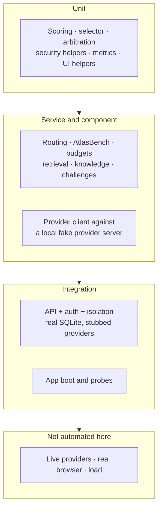

# Testing and results

Everything below was run on 2026-10-30, with the audit on 2026-11-19. Numbers are copied from the actual runs, and anything that was **not** run is listed in [What was not verified](#what-was-not-verified).

**Environment:** macOS (Apple silicon), Python 3.13.5, Node v26.3.0, dependencies installed from `requirements-dev.txt`, no real provider keys, `APP_ENV=development`.

## Results at a glance

| Suite | Command | Result |
|---|---|---|
| Backend (pytest) | `python -m pytest -q` | **1,252 passed, 4 skipped, 0 failed** (about 135 s) |
| Provider suite (stdlib `unittest`) | `python -m unittest discover -s backend/providers/tests -t .` | **121 tests, OK** (about 42 s) |
| Browser end-to-end (Playwright, run as scripts) | `python frontend/tests/e2e/test_compare_e2e.py` and `test_frontend_e2e.py` | Compare **42/42**. Frontend **113/113** |
| Frontend unit tests (Node) | `node backend/tests/js/*.test.js` | **9 files, all pass** (AtlasBench 25, Compare 16, Knowledge 34, Playground 12, Routing 14, link safety 4, API base 6, session persistence 5, Workflow Studio 8) |
| Frontend syntax | `node --check frontend/js/*.js` | All files pass |
| Python compile | `python -m compileall backend main.py start.py deploy` | Passes |
| App boot | Start the real FastAPI app | `/ready` 200, `/health` `ok` with the real embedding model loaded |

## Test layers



Providers are never called for real: tests use scripted fake clients and, for the Compare client, a local fake provider server. That makes the suite fast, free and deterministic, and it is also the main limit of what it proves.

## What the suite covers

| Area | Examples of what is asserted |
|---|---|
| **Authorization and isolation** | One user cannot read or change another user's research, notes, Playground conversations, workflows, benchmark runs or routing policies |
| **Auth and API security** | Argon2id hashing and legacy-hash migration, token tampering and expiry, rate limits, admin-only routes, generic errors, security headers, request-size cap, SSRF blocking |
| **Retrieval** | BM25, dense search, rank fusion, reranking and metadata filters |
| **Knowledge Map and Challenges** | Stable IDs, claim change tracking, freshness, the six challenge types and state machine |
| **AtlasBench** | Deterministic scoring, content hashing and reproduction, resumable runs with leases, retries, arbitration and abstention |
| **Routing and budgets** | Autopilot selection, fallback only on provider trouble, **atomic daily-limit reservation under concurrency**, per-user and global spend caps |
| **Compare** | Provider adapters, retries with `Retry-After`, the error taxonomy, circuit breaker, key redaction, cost accounting |
| **Observability** | Request-ID correlation, log redaction of key shapes, safe error responses, request metrics |
| **Frontend** | UI modules, link safety, palette and accessibility checks |

## Boot and configuration checks

These were run against the real application, not stubs.

| Check | Result |
|---|---|
| `GET /ready` | 200 `{"status": "ready"}` |
| `GET /health` | 200, `ok`, `embeddings_available: true`, mode `sentence_transformers` |
| `GET /api/admin/metrics` without a token | 401 |
| Response headers | `X-Request-ID`, `X-Content-Type-Options: nosniff`, `X-Frame-Options: DENY`, `Content-Security-Policy` present |
| Production start, placeholder `SECRET_KEY` | **Refused** (`ConfigurationError`) |
| Production start, wildcard CORS | **Refused** |
| Production start, no per-user spend cap | **Refused** |
| Production start, valid config plus global cap | **Starts**, `/ready` 200, global cap loaded |

## Docker image

Built and run locally on Docker Desktop 29.7.2 (Apple Silicon, linux/arm64) on 2026-10-31.

| Check | Result |
|---|---|
| `docker build` | Succeeded. Image is about 2.6 GB. Building from scratch took roughly 14 minutes. |
| Container start | Production mode, throwaway secrets, dummy provider keys. `/ready` returned 200 about 10 s after start. |
| `/health` | `ok`, with `embeddings_mode: sentence_transformers` (the model baked into the image loaded offline). |
| Frontend | `GET /` returned 200 from the same origin. |
| Demo seeding and login | `seed_demo` created the account and `POST /api/auth/login` succeeded. |
| Runtime user | uid 1000, as Hugging Face Spaces requires. |
| Docker `HEALTHCHECK` | Reported `healthy` after the start period. |

Found by building it:
- **Root-owned app directory.** `WORKDIR` ran before `USER user`, so `mkdir data/` failed during the build. Fixed by switching user first.
- **Two required provider keys.** The container exits at start-up unless `GROQ_API_KEY` and `TAVILY_API_KEY` are set, even in a smoke test.
- **A 304 carried the API's `default-src 'none'` CSP.** Revalidated static pages lost their content type, so the CSP middleware treated them as API responses and the browser blocked every script and style. Found only by loading the page in a real browser; now classified by path and covered by a test.
- **Flaky PyPI downloads.** Two builds failed in `pip install` on transient download errors. `PIP_RETRIES` and `PIP_DEFAULT_TIMEOUT` are now set in the Dockerfile. The linux/amd64 image (Hugging Face's architecture) was also built under emulation and passed the same checks: `uname -m` x86_64, `/ready` 200 after 15 s, demo login, and the Space `frame-ancestors` policy on pages with the API still `'none'`.

Container restarts were tested: with a mounted volume a registered user could still sign in afterwards; without one the data was gone. Not covered: real provider calls.

## What the first full run found

The first complete run of the suite, in a properly installed environment, reported **19 failures**. The earlier release reports had recorded these checks as "blocked" because dependencies could not be installed, so these failures had never been seen. I ran the same 19 against the untouched GitHub version: they fail there too, so they were already present and were not introduced by later changes.

| Cause | Tests | What was wrong | Fix |
|---|---|---|---|
| Tests patched code that had moved | 4 | The retry loop moved to `core/retry.py` in Sprint 4, but tests still patched `core.llm.time`. Two error tests patched `core.errors.get_settings`, which no longer exists. | Tests now patch the real locations. Product code unchanged. |
| Tests used retired models | 8 | Groq retired two Llama IDs on 2026-08-16 and the Playground rejects them on purpose, but its tests still used them | Tests use the supported `gpt-oss` models |
| Test expected an old message | 1 | Route errors return a fixed label such as "Listing reports failed. Please try again.", but one test expected the global handler's wording | Test asserts the label and that no internal detail leaks |
| Test asserted position, not content | 1 | A later change put the quality-threshold line first in the arbitration rationale | Test checks that the line is present |
| **Fixture missing from the repository** | 3 | `backend/tests/data/m5_retrieval_cases.json` was never committed: the `data/` rule in `.gitignore` matched that folder too | `.gitignore` now ignores only the top-level `/data/`. The three tests skip with an explicit reason until the file is restored. |
| Optional dependency absent | 1 | A test imports `posthog`, which the installed `chromadb` does not require | Skips when `posthog` is not installed |

After the fixes the suite is green. The four skips are the fixture-dependent and `posthog` tests above. **They are skips, not passes**, and the missing frozen retrieval cases mean the real-embedding quality benchmark is currently not being exercised.

A separate defect was also found in my own CI workflow: a plain `pytest` also collected the browser end-to-end tests under `frontend/tests/e2e`, which need Playwright. `pytest.ini` now limits default discovery to `backend`.

## What was not verified

| Not verified | Why it matters |
|---|---|
| **Live provider calls** (Groq, Tavily, OpenAI, Anthropic, Gemini, xAI) | No keys were used. Request and response shapes were tested against fake servers, so a real provider may differ in a field. |
| **Model quality** | No benchmark was run against real models, so there are no rankings or accuracy numbers |
| **Python 3.11 and 3.12** | The README supports 3.11 and newer; only 3.13 was used |
| **Load, concurrency at scale and long-running behaviour** | Only the atomic-reservation test exercises concurrency |
| **A deployed instance on Hugging Face Spaces** | The Docker image was built and run locally (see "Docker image" below), but it has not been deployed to a Space, so the platform proxy, secrets and ephemeral disk are untested. |
| **Frozen retrieval cases** | The fixture is missing, so those three tests are skipped |
| **The fourth skipped test** | `test_chroma_telemetry.py` needs `posthog`, which the installed chromadb does not depend on |

### Dependency advisories (`pip-audit`, 2026-11-19)

| Package | Advisories | Fix needs | Exposure in Atlas |
|---|---|---|---|
| `chromadb` 1.5.9 | server-mode code injection and authorization (5) | no fixed version yet | Atlas uses only the embedded `PersistentClient`; it runs no Chroma server or auth provider |
| `langgraph`, `langgraph-checkpoint`, `langgraph-sdk` | 2, 4 and 3 | LangGraph 1.x | Pinned below 1.0 on purpose; a major upgrade needs its own testing |
| `langchain-core`, `langchain-openai` | 3 and 2 | LangChain 1.x | As above |
| `transformers`, `sentence-transformers` | 9 and 1 | Transformers 5, sentence-transformers 5 | Local embedding model only; no untrusted model files are loaded |
| `lxml` | XML entity resolution | 6.1 (applied) | Used only as an HTML parser for scraping |

Upgrading the major-version ones is the first item for a follow-up release.

## Full-project audit (2026-11-19)

| Check | Result |
|---|---|
| Static analysis (ruff F/B/S rules) on production code | 12 unused imports removed; the 15 dynamic-SQL sites build only from hard-coded column and table names with bound values (no injection path); 93 `Depends()` and 11 `raise ... from` notes are style only |
| Dead code | `backend/services/verification_service.py` (145 lines, imported nowhere, superseded by `VerificationAgent`) removed |
| All-routes smoke test | All 99 routes with empty, malformed and hostile inputs plus no token: **0 server errors**; every protected route refuses anonymous calls; admin routes return 403 to normal users; a tampered token is rejected; an oversized body gets 413 |
| Frontend to backend contract | All 50 API call sites in `frontend/js` match a real route and method |
| Secret scan | Working tree and full Git history: only obvious test fixtures (`gsk_1234...`). No real key was ever committed. |
| Dependency audit (`pip-audit`) | 9 packages with advisories. `lxml` raised to 6.1+. The rest need major-version upgrades (LangGraph, LangChain, Transformers, sentence-transformers) or have no fix yet (chromadb); see the table below. |
| Fresh-clone start | `python start.py` (with `PORT` set) reached `/ready` in about 6 s; landing page, workspace and `/docs` return 200 |

## Reproducing these results

```sh
python3 -m venv .venv && source .venv/bin/activate
pip install torch --index-url https://download.pytorch.org/whl/cpu
pip install -r requirements-dev.txt

export APP_ENV=development SECRET_KEY=any-random-string-of-32-or-more-characters
python -m pytest -q
python -m unittest discover -s backend/providers/tests -t .
for f in frontend/js/*.js; do node --check "$f"; done
for f in backend/tests/js/*.test.js; do node "$f"; done
```

The same steps run in [GitHub Actions](../.github/workflows/ci.yml) on every push and pull request.
