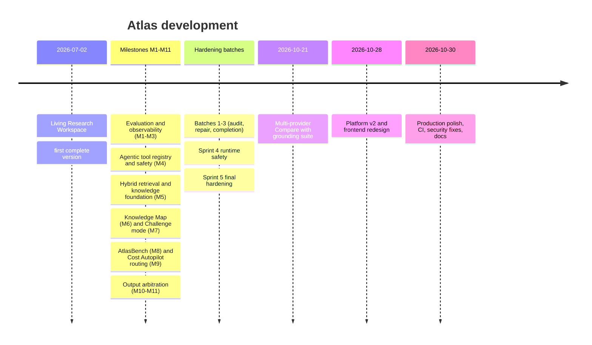

# Development history

Atlas was built in milestones, then hardened in a series of batches and sprints. Each stage started from a frozen baseline, fixed bounded, root-caused defects, and recorded what was and wasn't verified. This page replaces the per-batch reports that used to live in `docs/`.

## Timeline

## Phase 1: Living Research Workspace (2026-07-02)

First complete version (commit "complete Atlas Living Research Workspace"): a research workspace on FastAPI, LangGraph, SQLite and ChromaDB. The later phases below are reconstructed from the milestone test files and the per-batch reports, not from commit-by-commit history, because the repository was published as a small number of large commits.

## Phase 2: Milestones M1 to M11

| Milestone | Delivered |
|---|---|
| **M1 to M3** | Evaluation metrics, an end-to-end test, and observability and safety controls |
| **M4** | Agentic planning over a closed tool registry, bounded re-planning, untrusted-data wrapping, security and reliability tests |
| **M5** | Hybrid retrieval (BM25 + dense, reciprocal-rank fusion, feature reranker, MMR) and the knowledge foundation: stable IDs for source, evidence, claim and entity |
| **M6** | Knowledge Map: per-user graph, claim change tracking, source freshness |
| **M7** | Challenge mode: six adversarial challenge types and six result states |
| **M8** | AtlasBench: frozen tasks, deterministic scoring, resumable runs with leases, reproduction |
| **M9** | Routing and Cost Autopilot: explicit and autopilot policies, bounded fallback, usage recording |
| **M10 to M11** | Output arbitration over stored measured scores, with abstention when evidence is too thin |

## Phase 3: Hardening batches

| Stage | Problem found | Fix |
|---|---|---|
| **Batch 1** | Entity extraction treated standalone month names as entities. The Playground showed unclear cost labels and weak contrast. | Months are now temporal context unless part of a multi-token name. Cost labelled as "Pre-call estimate" vs "Usage-based estimate", and "Not reported" instead of $0. |
| **Batch 2** | A router was not registered on the app. Exhausted benchmark runs could remain stale. | Router registration fixed with a runtime test. Stale-run terminalization policy added and tested. |
| **Batch 3** | Arbitration had no configurable quality floor. The daily-limit check wasn't proven atomic. | Added `ATLASBENCH_MIN_ARBITRATION_QUALITY`. A concurrent-reservation test proves only one request passes a limit of one. Abstention is persisted. |
| **Sprint 4** | HTTP 413 (payload too large) was retried as if rate-limited. Recognisable provider keys could appear in generic error strings. | Retry logic extracted to `core/retry.py`. Only 429 is retried. Log redaction now matches `gsk_`, `sk-proj-`, `sk-` and `tvly-` token shapes. |
| **Sprint 5** | The global error handler could return exception text and log full URLs and tracebacks, which can carry reset tokens and credentials. | Same generic error message in every environment. Logs record path, method, exception type and sanitised stack locations only. |

## Phase 4: Compare, v2 and redesign

- **Multi-provider Compare (2026-10-21).** Real adapters for OpenAI, xAI, Anthropic and Gemini with a normalised response type, per-attempt timeouts, jittered retries honouring `Retry-After`, an 18-category error taxonomy, a per-provider circuit breaker, concurrency limits, a model and price catalog with verification dates, and a 24-case grounding suite with confidence intervals.
- **Platform v2 (2026-10-28).** One commit brought multi-provider Compare, AtlasBench, routing and auth into the repository. The same codebase includes Workflow Studio, per-user budgets, admin audit logging and the single-container Hugging Face deployment.
- **Frontend redesign.** A from-scratch static frontend: separate public site, auth page and workspace, one design-token file, no framework.

## Phase 5: Production polish (2026-10-30)

| Area | Change |
|---|---|
| Frontend security | `javascript:` and `data:` URLs in LLM-written markdown and in source links no longer become clickable links. A shared `safeUrl()` allows only `http(s)`. Regression tests added. |
| Reliability | Six silent `except: pass` blocks now log a warning with the exception type, or catch only the exception they expect |
| CI | GitHub Actions: compile check, Python suite, provider suite, Node syntax checks and UI tests |
| Build | `pytest` moved out of runtime requirements into `requirements-dev.txt`. Added `.dockerignore` and a container `HEALTHCHECK` on `/ready`. |
| Deployment | Proxy trust is configurable through `FORWARDED_ALLOW_IPS` |
| Docs | Sixteen batch and sprint reports replaced by this set. See the [changelog](CHANGELOG.md). |

## What the earlier reports taught

A recurring theme in the original reports was that dependency installation was blocked in the build sandbox, so many checks were recorded as *blocked* rather than *passed*, and the releases were deliberately not labelled production-ready. That discipline is the reason the claims in this documentation set are limited to what was actually run. The most recent verified results are in [Testing and results](04-testing-and-results.md).
