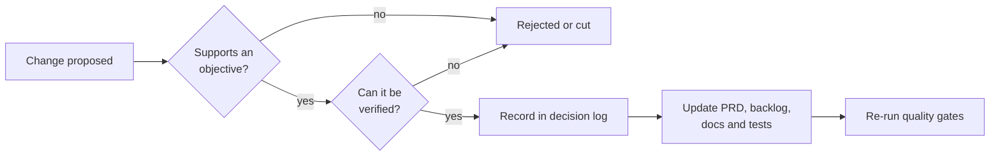

# Project charter

| | |
|---|---|
| Project | Atlas |
| Owner | Shreya Joshi (product owner, project manager, engineer, tester, writer) |
| Start | 2026-07-02 (first commit) |
| Status at this revision | Released as 2.1.1 on 2026-11-25; closed with open items (see the [closure report](06-project-closure-report.md)) |
| Related | [PRD](01-prd.md) · [Roadmap](02-roadmap-and-milestones.md) · [Risks](04-risk-register.md) · [Decisions](07-decision-log.md) |

## 1. Problem and opportunity

Language-model answers read as confident whether or not they are true. Checking one means redoing the research, so people either trust the answer blindly or do not use it. A second problem sits behind it: teams that choose a model usually rely on opinion and demos, not on repeatable tests.

Atlas addresses both. It produces research reports in which **every claim stays linked to its source**, and it provides tools to **measure the models** behind that research, so a model is chosen on measured results.

## 2. Vision and objectives

**Vision.** Research you can trace. AI you can measure.

| ID | Objective | Measure of success | Result (see closure report) |
|---|---|---|---|
| O1 | Turn a question into a cited report with claim-level verification | A run produces a report whose claims each link to evidence and carry a verification label | Met |
| O2 | Make model quality measurable without an LLM judge | Deterministic scoring on frozen tasks; same input gives the same score | Met (built and tested; no live-model results yet) |
| O3 | Control cost before and during model calls | Worst-case estimate before a run; budget reserved before the call; caps enforced | Met |
| O4 | Keep each user's data separate and the service secure | Isolation tests pass; auth, rate-limit and injection controls in place | Met |
| O5 | Be deployable by someone else from the documentation | One container; documented deployment; health probes | Met (live on Render) |
| O6 | State only what was verified | A documented list of what was not verified; no rankings without data | Met |
| O7 | Demonstrate the product with a working public link | Sign-up, sign-in and research work on the live site | **Partly met**: fixed and verified locally on 2026-11-25; confirmation on the hosted site is open (backlog B-01) |

## 3. Scope

**In scope (four workspace areas)**

| Area | Purpose |
|---|---|
| Overview | Entry point with the user's recent activity |
| Research | New case, Cases, Library, Knowledge map, Insights, Challenge mode, grounded chat, notes |
| AI Playground | One question to up to four models, optionally with the same sources; compare time, tokens, cost and citations, and read each answer in full |
| AtlasBench | Frozen-task model scoring and the Routing & cost tab (Cost Autopilot, budgets). Run comparison and arbitration are available through the API |

Supporting: accounts and authentication, admin controls and monitoring, a single-container deployment, and CI.

**Out of scope**

| Item | Why |
|---|---|
| Document upload | Needs malware scanning and storage design |
| Horizontal scaling (Postgres, shared limiter, hosted vector store) | The product is single-instance by design |
| Email delivery (password reset) | No email provider |
| Token revocation | Hand-rolled signed tokens; revocation is a later step |
| Voice, mobile app, real-time collaboration | Not needed for the objectives |
| Discover (search-by-meaning page) | Built, then removed after 2.1.1 (decision D-19): it did not work on the demo and overlapped Cases and Library |
| **Workflow Studio** | Built, then **removed** in 2.1.1 (decision D-12) because it did not support the objectives and was hard to explain |

## 4. Deliverables

Working application (API and frontend), single-container image and CI pipeline, the documentation set in `docs/`, this management pack, and the live demo.

## 5. Stakeholders

There are no external customers. The personas below are hypotheses about who would use the product and have **not** been validated by interviews (backlog B-10).

| Stakeholder | Interest | Influence | How engaged |
|---|---|---|---|
| Project owner (Shreya Joshi) | Delivers, decides scope, accepts the result | High | Every decision recorded in the [decision log](07-decision-log.md) |
| Analyst or researcher (persona) | Trust a report enough to act on it | Medium | Requirements derived from the persona; not interviewed |
| Team choosing a model (persona) | Evidence for "model A over B" before spending money | Medium | As above |
| Operator who deploys it | Runs it safely and cheaply | Medium | Deployment guide and runbook |
| Reviewers (hiring managers, engineers) | Judge the work from the repository, docs and live demo | High for the owner's goals | Docs written to be read cold |

## 6. Roles and responsibilities (RACI)

One person holds every role. The table is kept so the separation of duties is explicit and a larger team could take the roles over.

| Activity | Product owner | Project manager | Engineer | Tester | Writer |
|---|---|---|---|---|---|
| Set scope and priorities | A/R | C | C | | |
| Write requirements | A/R | C | C | C | |
| Plan and track delivery | C | A/R | C | | |
| Build | | | A/R | | |
| Verify quality | C | C | C | A/R | |
| Document | C | C | C | | A/R |
| Accept release | A/R | C | | C | |

R responsible, A accountable, C consulted.

## 7. Approach

- **Milestone-based delivery**, each milestone with its own tests (M1 to M11), then hardening batches and sprints that each started from a frozen baseline and fixed bounded, root-caused defects.
- **Evidence over assertion.** A claim in the documentation must come from a run. Checks that could not run were recorded as not verified, not as passed.
- **Change control.** Scope changes go through the [decision log](07-decision-log.md): state the change, the alternatives, the reason and the consequence, then update every affected document.

## 8. Assumptions, constraints and dependencies

| Type | Item |
|---|---|
| Assumption | Providers keep their API shapes; model IDs and prices change often (verified against the catalog date) |
| Assumption | A single instance is enough for a demo and a small team |
| Constraint | No budget for paid hosting; the demo runs on free tiers (512 MB memory, ephemeral disk) |
| Constraint | Only free-tier keys (Groq, Gemini, Tavily), so OpenAI, Anthropic and xAI are supported in code but not offered on the demo |
| Constraint | One person, so scope has to stay small enough to test fully |
| Dependency | Groq (language model), Tavily (search), GitHub (source and CI), Render (hosting) |

## 9. Communication and reporting

| What | Audience | Where | When |
|---|---|---|---|
| Release notes | Anyone using or reviewing the project | [Changelog](../CHANGELOG.md) | Every release |
| Quality results | Reviewers | [Testing and results](../04-testing-and-results.md) and the [QA report](05-qa-report.md) | After each full run |
| Decisions and scope changes | Owner and reviewers | [Decision log](07-decision-log.md) | When a decision is made |
| Risks and issues | Owner | [Risk register](04-risk-register.md) | Reviewed at each release |
| Operations | Operators | [Runbook](../06-runbook.md) | Updated with each incident |

## 10. Budget and resources

Target infrastructure cost: **zero** (free tiers for hosting, source control and CI). Model API usage is bounded by spend caps in the product itself (per request, per user, and app-wide). Effort was not tracked in hours, so no effort figures are claimed.
