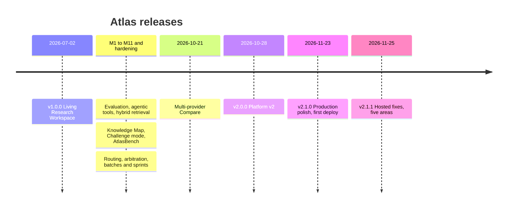

# Roadmap and milestones

| | |
|---|---|
| Related | [Backlog](03-product-backlog.md) · [Development history](../05-development-history.md) · [Changelog](../CHANGELOG.md) |

## 1. How to read the dates

Release dates are the dates of the merging commits in Git. The milestones M1 to M11 and the hardening batches were built between the first commit (2026-07-02) and release 2.0.0 (2026-10-28); the repository was published as a few large commits, so their exact dates were not recorded and are not claimed here.

## 2. Delivered

| Milestone | Date | Deliverable | Status |
|---|---|---|---|
| **v1.0.0** Living Research Workspace | 2026-07-02 | Research pipeline, ranking, verification, credibility, brief, notes, chat, history on FastAPI, SQLite and ChromaDB | Done |
| M1 to M3 | before 2026-10-28 | Evaluation metrics, an end-to-end test, observability and safety controls | Done |
| M4 | before 2026-10-28 | Agentic planning over a closed tool registry, bounded re-planning, untrusted-data wrapping | Done |
| M5 | before 2026-10-28 | Hybrid retrieval and the knowledge foundation | Done |
| M6 | before 2026-10-28 | Knowledge Map | Done |
| M7 | before 2026-10-28 | Challenge mode | Done |
| M8 | before 2026-10-28 | AtlasBench | Done |
| M9 | before 2026-10-28 | Routing and Cost Autopilot | Done |
| M10 to M11 | before 2026-10-28 | Output arbitration | Done |
| Hardening: batches 1 to 3, sprints 4 and 5 | before 2026-10-28 | Bounded defect fixes (see [development history](../05-development-history.md)) | Done |
| Multi-provider Compare | 2026-10-21 (per development history) | Four provider adapters, catalog, 24-case grounding suite | Done |
| **v2.0.0** Platform v2 | 2026-10-28 | Compare, AtlasBench, routing and auth in one repository; redesigned frontend | Done |
| **v2.1.0** Production polish | 2026-11-23 | Docker image, CI, security fixes, documentation set, UI redesign (pull request #1) | Done |
| **v2.1.1** Hosted-deployment fixes | 2026-11-25 | Small-host mode, API docs off in production, scope reduced to five areas, explainer panels | Done; hosted confirmation open (B-01) |

## 3. Forward roadmap

No dates are promised; the order follows value and risk. IDs refer to the [backlog](03-product-backlog.md).

| Horizon | Theme | Items |
|---|---|---|
| **Now** | Make the public demo trustworthy | B-01 confirm sign-up, sign-in and research on the hosted site; B-04 re-run the browser tests; B-03 let Compare run on the demo by adding Groq |
| **Next** | Turn "built" into "measured" | B-02 run a live comparison on at least two providers and publish pass rates with intervals; B-10 interview analysts to test the personas |
| **Later** | Production hardening | B-05 persistent storage, B-06 background research jobs, B-07 dependency upgrades, B-08 token revocation, B-09 Postgres and a hosted vector store |
| **Maybe** | Reach | B-12 document upload, B-13 email for password reset |

## 4. Release criteria for the next release

1. B-01 closed: sign-up, sign-in and one research run confirmed on the live site.
2. All suites pass and the browser end-to-end tests are re-run (B-04).
3. Every document still agrees with the facts table in the [project README](README.md).
