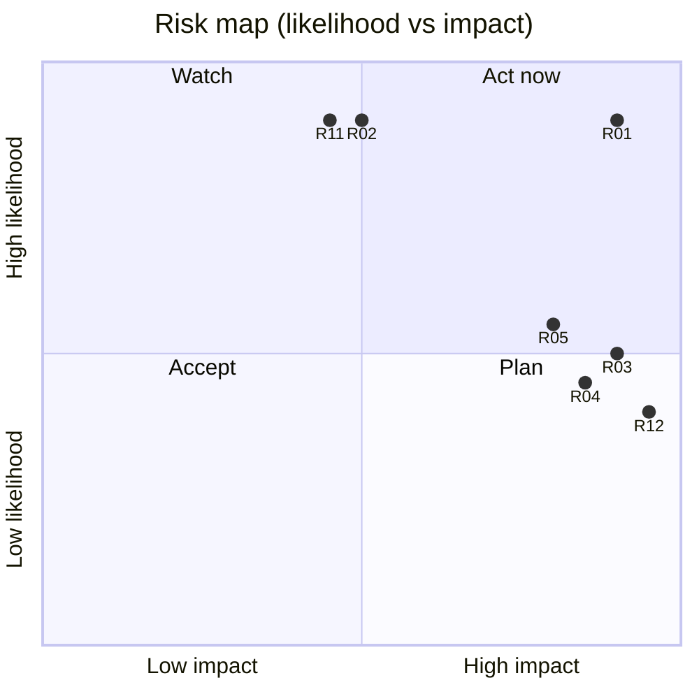

# Risk and issue register

Likelihood and impact are rated Low, Medium or High. **Score** is likelihood times impact (Low 1, Medium 2, High 3), from 1 to 9. The owner of every item is the project owner (Shreya Joshi), because there is no other team member. Last reviewed 2026-11-25.

| | |
|---|---|
| Related | [Backlog](03-product-backlog.md) · [QA report](05-qa-report.md) · [Decision log](07-decision-log.md) |

## 1. Risks

| ID | Risk | L | I | Score | Mitigation | Status |
|---|---|---|---|---|---|---|
| R-01 | The public demo fails when a reviewer opens it (restarts, cold start, research errors) | H | H | 9 | Small-host mode; demo account re-created at start; keep-alive monitor on `/ready`; read-only hosted checks; B-01 to confirm end to end | **Open** (occurred, see I-01 and I-02) |
| R-02 | Free hosting wipes the disk, so accounts and reports vanish | H | M | 6 | Demo account via `DEMO_EMAIL` and `DEMO_PASSWORD`; keep-alive; documented in the runbook. Root fix is a persistent disk (B-05). | Mitigated, accepted |
| R-03 | A research run is cut by a hosted proxy time limit (about 100 s) | M | H | 6 | Fewer sources and no extra model calls in small-host mode; B-06 for background jobs | Open |
| R-04 | Model spend runs away | M | H | 6 | Worst-case estimate before a run, per-request ceiling, atomic reservation, per-user and app-wide caps, production startup refuses without a cap | Mitigated |
| R-05 | Claims about model quality are not backed by data | M | H | 6 | No rankings shipped; rankings only when 95% intervals do not overlap; "not verified" list in the docs; B-02 | Mitigated; B-02 open |
| R-06 | Single instance and SQLite cannot scale | H | L | 3 | Stated as a design limit; B-09 describes the path | Accepted |
| R-07 | Dependency vulnerabilities | M | M | 4 | `pip-audit` run; `lxml` upgraded; the remaining 8 packages need major upgrades (LangGraph, LangChain, Transformers, sentence-transformers) or have no fix (chromadb); exposure assessed per package | Open (B-07) |
| R-08 | Stolen or leaked tokens cannot be revoked | L | M | 2 | Tokens expire (7 days by default); rotating `SECRET_KEY` signs everyone out; B-08 | Accepted |
| R-09 | The product solves a problem users do not have | M | M | 4 | Personas are labelled as hypotheses; B-10 interviews | Open |
| R-10 | Retrieval-quality regressions go unnoticed | M | M | 4 | Three tests are skipped because a fixture was never committed; stated openly; B-11 | Open |
| R-11 | Provider APIs, model IDs or prices change | H | M | 6 | Prices and IDs live in a dated catalog; the UI warns after 60 days; an admin discovery route checks IDs against real keys; Groq retired two model IDs on 2026-08-16 and the Playground rejects them on purpose | Mitigated, ongoing |
| R-12 | Prompt injection through scraped pages | M | H | 6 | Untrusted-data wrapper, signal detection, a closed tool registry with no acting tools, canary checks in evaluation | Mitigated |
| R-13 | Secrets committed to the repository | L | H | 3 | `.env` and data ignored; secret scan of the tree and full history found only test fixtures; placeholder keys count as unset | Mitigated |
| R-14 | Documentation drifts from the product | M | M | 4 | One facts table in the [project README](README.md); a search for removed features across all documents before release | Mitigated |
| R-15 | Scope creep from a single person adding features | M | M | 4 | Change control through the decision log; Workflow Studio removed in 2.1.1 | Mitigated |

## 2. Issues that occurred

| ID | Issue | Found | Cause | Resolution | Status |
|---|---|---|---|---|---|
| I-01 | Research failed on the hosted site; sign-out returned 502 | 2026-11-25 | One research run needed about 870 MB, the free instance has 512 MB, so the app was killed and restarted | Small-host mode (decision D-11); locally a run peaks at about 210 MB | Fixed locally; hosted confirmation open (B-01) |
| I-02 | Accounts created on the hosted site could not sign in later ("invalid login") | 2026-11-25 | The restart in I-01 reset the free disk, deleting the accounts | Demo account re-created at every start; keep-alive monitor; documented | Mitigated; root cause accepted (R-02) |
| I-03 | Docker build failed with `mkdir: Permission denied` | 2026-11-23 | The deployed branch had the older Dockerfile (`WORKDIR` before `USER`) | Fixed in the Dockerfile, covered by a local build on both architectures | Closed |
| I-04 | Compare could not run on the demo | 2026-11-25 | It needs a key for OpenAI, Anthropic, Gemini or xAI; the demo has Groq and Tavily only | Compare stays in the menu and the docs say it needs provider keys; B-03 proposes adding Groq | Open |
| I-05 | A live evaluation attempt returned only provider errors | 2026-11-23 | OpenAI quota exhausted; Gemini overloaded; xAI request rejected. All 72 calls failed, so nothing was spent and no result was saved. | Not retried (no budget); B-02 | Open |
| I-06 | CI failed: 46 provider tests errored during setup | 2026-11-23 | The provider test step lacked `GROQ_API_KEY` and `TAVILY_API_KEY` | The workflow step sets test values | Closed |
| I-07 | API documentation was public on the live site | 2026-11-25 | Swagger UI was always on | Off in production unless `ENABLE_API_DOCS=true` | Closed |
| I-08 | Menu items that could not be demonstrated or explained | 2026-11-25 | Workflow Studio, Runtime & Control, and Compare without keys | Scope reduced (decisions D-12, D-13); explainer panels added | Closed |
