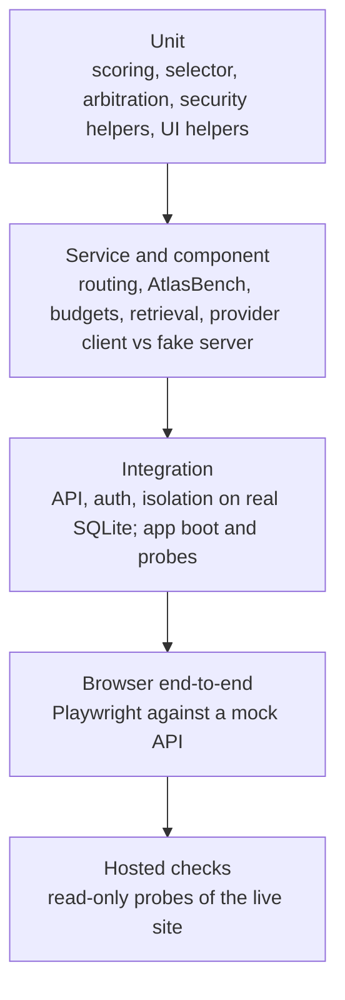

# QA report

| | |
|---|---|
| Release under test | 2.1.1 |
| Test dates | Suites re-run 2026-11-25; browser end-to-end last run 2026-11-23 |
| Tester | Project owner (no independent tester) |
| Detail and commands | [Testing and results](../04-testing-and-results.md) |
| Related | [PRD](01-prd.md) · [Risk register](04-risk-register.md) |

## 1. Summary

The automated suites pass. The product has **not** been tested against live model providers, and research on the hosted site has not been re-confirmed since the 2026-11-25 fixes. Those two gaps are the main residual risk. Recommendation: acceptable for a demonstration, with the open items below tracked in the [backlog](03-product-backlog.md).

## 2. Scope and environment

| | |
|---|---|
| In scope | Backend API, research pipeline, retrieval, Knowledge Map, Challenge mode, Playground, Compare client, AtlasBench, routing, budgets, auth, isolation, admin, frontend modules, the container image |
| Test data | Stubbed providers, a local fake provider server, real SQLite, frozen fictional evidence for AtlasBench |
| Environment | macOS on Apple silicon, Python 3.13, Node, Docker Desktop; CI on Ubuntu with Python 3.13 and Node 22 |
| Not in scope | Live provider quality, load and scale, Python 3.11 and 3.12, a Hugging Face Space |

## 3. Test strategy

## 4. Results (2026-11-25)

| Suite | Result |
|---|---|
| Backend (`python -m pytest -q`) | **1,244 passed, 4 skipped, 0 failed** |
| Provider suite (`unittest`) | **121 tests, OK** |
| Frontend unit tests (Node) | **8 files, all pass** (AtlasBench 25, Compare 16, Knowledge 34, Playground 12, Routing 14, link safety 4, API base 6, session persistence 5) |
| Browser end-to-end | Compare 42/42 and Frontend 113/113 on 2026-11-23. **Not re-run** since the menu change (see section 6). |
| Python compile and JS syntax | Pass |
| Hosted read-only checks | `/ready` 200; `/health` ok with `embeddings_mode: onnx`; `/docs` 404; `/api/auth/me` 401 without a token; pages 200 with no console errors |
| Local research run in small-host mode | Completed in about 40 to 65 s over three runs; the report appeared in the Library; the same account signed in again |

**Skipped tests (4).** Three need `backend/tests/data/m5_retrieval_cases.json`, which was never committed; one needs the optional `posthog` package. They are skips, not passes (backlog B-11).

## 5. Requirements coverage

Every requirement in the [PRD](01-prd.md) names the tests that verify it. Coverage by area:

| Area | Requirements | Verified by | Result |
|---|---|---|---|
| Research pipeline and agents | FR-01 to FR-04 | Milestone, planner, execution, tool-registry and verification tests | Pass |
| Retrieval and knowledge | FR-05 to FR-07 | Hybrid retrieval, Knowledge Map and Challenge tests | Pass (3 skips) |
| Notes, chat and views | FR-08, FR-09 | Notes and API tests, browser e2e | Pass |
| Evaluation | FR-10 to FR-13 | Playground, provider suite, AtlasBench, arbitration, routing tests | Pass (fake providers only) |
| Budgets and accounts | FR-14 to FR-16 | Spend-cap, runtime-control, auth, isolation and metrics tests | Pass |
| Non-functional | NFR-01 to NFR-09 | Security, reliability, isolation, metrics suites and CI | Pass; NFR-07 hosted confirmation open |

## 6. What was not checked

| Gap | Why it matters | Backlog |
|---|---|---|
| Live provider calls (Groq, Tavily, OpenAI, Anthropic, Gemini, xAI) | Request and response shapes were tested against fakes only | B-02 |
| Model quality | No benchmark ran on real models, so there are no rankings | B-02 |
| Hosted research, sign-up and sign-in after the 2026-11-25 fixes | Verified locally with the same settings; the free instance is slower | B-01 |
| Browser end-to-end after the menu change | The scripts were updated but Playwright was not installed that day | B-04 |
| Python 3.11 and 3.12 | The README supports them; only 3.13 was used | |
| Load, scale and long-running behaviour | Only the atomic-reservation test exercises concurrency | |
| A Hugging Face Space | Docker Spaces need a paid plan; the image was built and run locally | |

## 7. Defect log

Severity: Critical (product unusable), High (feature broken or security issue), Medium (wrong behaviour with a workaround), Low (cosmetic or process).

| ID | Defect | Severity | Found by | Fix | Status |
|---|---|---|---|---|---|
| DEF-01 | 19 failures on the first full run: tests patched moved code (4), used retired models (8), expected an old message (1), asserted position not content (1), missing fixture (3), optional dependency absent (1) | Medium | Full suite | Tests corrected; fixture tests skip with a reason | Closed |
| DEF-02 | Docker build failed: `WORKDIR` ran before `USER`, so `data/` could not be created | High | Docker build | Switch user first | Closed |
| DEF-03 | A 304 response carried the API's `default-src 'none'` CSP, so the browser blocked every script and style | High | Browser | CSP chosen by path, with a test | Closed |
| DEF-04 | Flaky PyPI downloads failed two builds | Low | Docker build | `PIP_RETRIES` and a longer timeout | Closed |
| DEF-05 | Plain `pytest` also collected the browser tests, which need Playwright | Low | CI | `pytest.ini` limits discovery to `backend` | Closed |
| DEF-06 | Form messages shifted the layout, so the first click on the submit button was lost | Medium | Browser e2e | Space reserved for messages | Closed |
| DEF-07 | A stale `atlas_api_base` in `localStorage` overrode the same-origin default, so sign-up failed with "Could not reach the server" | High | Review of the connectivity issue | One resolver in `js/config.js`; old key removed | Closed |
| DEF-08 | "Keep me signed in" unchecked was ignored once the workspace loaded | Medium | Review | Refresh keeps the stored choice, with tests | Closed |
| DEF-09 | Static files had no `Cache-Control`, so browsers kept old JS and CSS after a deploy | Medium | Review | `no-cache` with ETag | Closed |
| DEF-10 | Markdown links with `javascript:` or `data:` URLs became clickable | High | Security review | Shared `safeUrl()` allows only `http(s)`, with tests | Closed |
| DEF-11 | The global error handler could return exception text and log full URLs | High | Hardening sprint 5 | One generic message; logs hold path, method and exception type | Closed |
| DEF-12 | HTTP 413 was retried as a rate limit; provider keys could appear in error strings | High | Hardening sprint 4 | Only 429 is retried; key shapes redacted | Closed |
| DEF-13 | CI provider step had no API keys (46 setup errors) | Medium | CI | Test values set in the workflow | Closed |
| DEF-14 | Research failed on a 512 MB host (about 870 MB needed); app restarted and accounts were lost | Critical | Live site | Small-host mode | **Fixed locally; hosted confirmation open (B-01)** |
| DEF-15 | API docs public in production | Low | Live site | Off unless `ENABLE_API_DOCS=true` | Closed |
| DEF-16 | The Back button could show a signed-out user's page from the browser cache | Medium | User report | Restored pages reload (defensive; the exact report was not reproduced on a healthy server) | Closed (unconfirmed reproduction) |
| DEF-17 | Earlier batches: unregistered router, stale benchmark runs, month names treated as entities, unknown costs shown as free | Medium | Hardening batches 1 and 2 | Fixed with tests | Closed |

## 8. Exit criteria and sign-off

| Criterion | Met? |
|---|---|
| All automated suites pass; skips explained | Yes |
| No open Critical or High defect | **No.** DEF-14 is fixed and verified locally but not yet confirmed on the hosted site. |
| Security checks (auth, isolation, injection, secrets, advisories) done and recorded | Yes; advisories remain open as risk R-07 |
| Gaps listed | Yes (section 6) |

**Outcome: conditional pass.** Release 2.1.1 is accepted for demonstration; full acceptance needs backlog item B-01.
