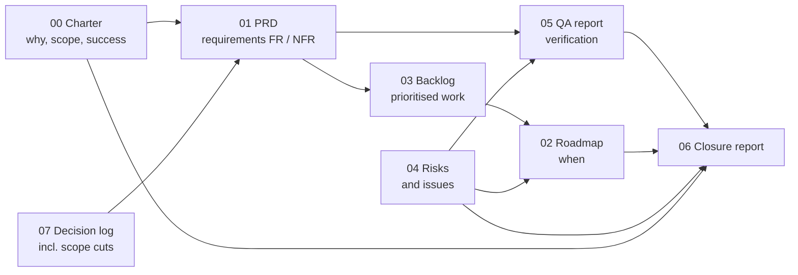

# Atlas: project management pack

This folder is the management record of the Atlas project: why it exists, what was promised, how it was planned, how it was checked, what went wrong, and where it stands. The engineering documentation (architecture, API, operations) is in the parent [`docs/`](../README.md) folder and describes the same product. Every number below was taken from a run or from the repository, and the same numbers are used in every document.

| # | Document | Question it answers |
|---|---|---|
| 00 | [Project charter](00-project-charter.md) | Why are we doing this, for whom, with what scope, who does what, and what counts as success? |
| 01 | [Requirements (PRD)](01-prd.md) | What exactly must the product do, and how is each requirement verified? |
| 02 | [Roadmap and milestones](02-roadmap-and-milestones.md) | When did things ship, and what comes next? |
| 03 | [Product backlog](03-product-backlog.md) | What is done, and what is left, in priority order? |
| 04 | [Risk register](04-risk-register.md) | What could go wrong, what already did, and what was done about it? |
| 05 | [QA report](05-qa-report.md) | How was quality checked, with what result, and what was not checked? |
| 06 | [Project closure report](06-project-closure-report.md) | Did the project meet its objectives, what was learned, what is handed over? |
| 07 | [Decision log](07-decision-log.md) | Which decisions shaped the product, including what was cut and why? |

## The project in one table

These are the reference facts. If another document disagrees with this table, this table is right and the other document has a defect.

| Fact | Value |
|---|---|
| Product | Atlas: an evidence-backed research workspace plus tools to measure the AI models behind it |
| Owner and delivery | One person (Shreya Joshi) acting as product owner, project manager, engineer, tester and technical writer. AI coding tools were used for review, testing and documentation support. |
| First commit | 2026-07-02 |
| Current release | **2.1.1**, 2026-11-25 |
| Live demo | https://atlas-cite-check.onrender.com (Render free tier) |
| Workspace areas | **Four**: Overview, Research, AI Playground, AtlasBench (Routing & cost is a tab inside AtlasBench) |
| Research pipeline | 12-node LangGraph workflow; closed registry of 5 tools |
| API | **89** operations on 75 paths |
| Model providers | 5 supported in code (Groq, OpenAI, Anthropic, Gemini, xAI). The demo offers 2 Groq and 2 Gemini free-tier models; those four were called for real in local checks. OpenAI, Anthropic and xAI were tested against fakes only |
| AtlasBench | 8 frozen tasks, 6 deterministic measures, no LLM judge |
| Grounding evaluation suite | 24 labelled cases |
| Backend tests | **1,245 passed, 4 skipped**, 0 failed (2026-11-26) |
| Provider suite | **121** tests, OK (2026-11-25) |
| Frontend unit tests | **7** files, all pass (2026-11-26) |
| Browser end-to-end | Compare 42/42 and Frontend 113/113 on 2026-11-23; **not re-run** after the menu changes of 2026-11-25 and 2026-11-26 |
| Live model rankings | **None.** Single live questions work, but the 24-case evaluation has not been run to completion on live models, so no ranking exists. |
| Real users | None. The user personas are hypotheses. |
| Known hosting limit | Free tier: 512 MB memory, disk wiped at every restart, first request after idle about a minute |

## How the documents fit together

IDs are stable across documents: **FR-** and **NFR-** requirements (01), **B-** backlog items (03), **R-** risks and **I-** issues (04), **DEF-** defects (05), **D-** decisions (07).
